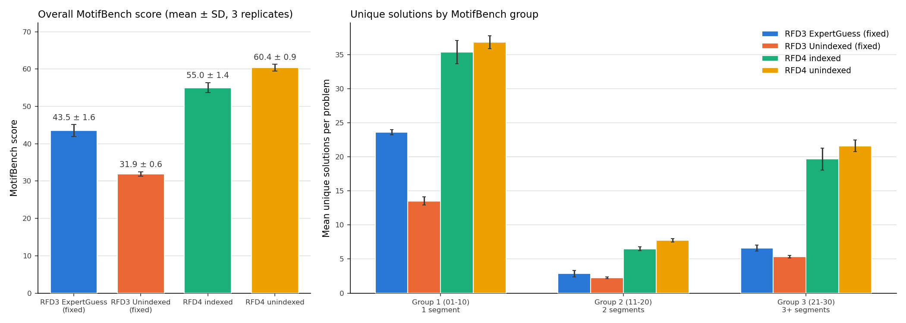
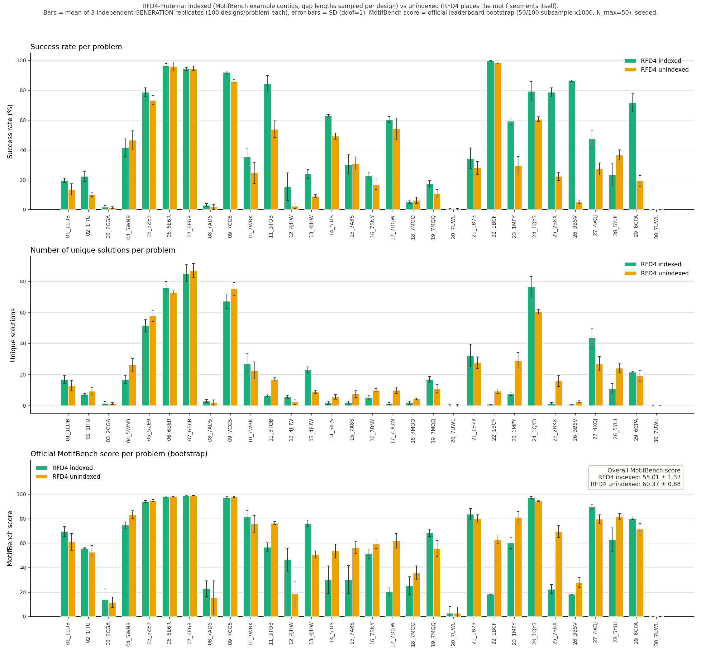
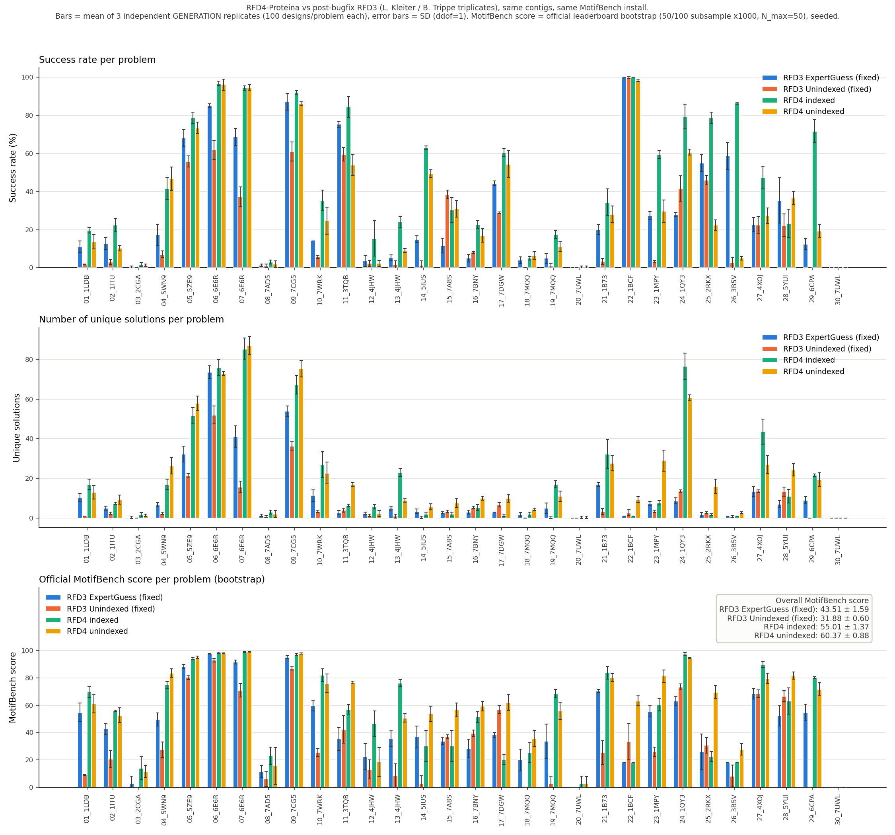
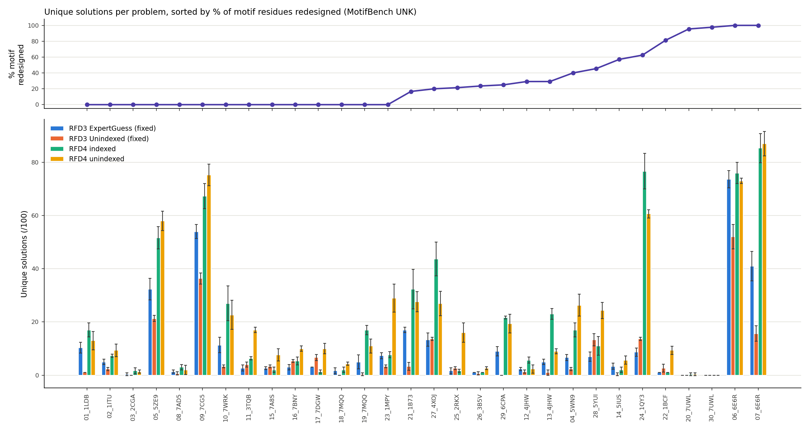

# RFD4-Proteina on MotifBench (indexed + unindexed, triplicates)

*Detailed write-up. The short submission overview is in [README.md](README.md).*

## General Information
All 30 [MotifBench](https://github.com/blt2114/MotifBench) benchmark problems, generated with
**RFD4-Proteina** (RosettaCommons / NVIDIA) on a cluster of the Technical University of Munich (TUM),
in two modes:

- **Indexed**: the motif segments are placed by contigs (the same contigs as the RFD3 runs).
- **Unindexed**: RFD4 decides where in the sequence each motif segment goes.

Each mode was run as **3 independent generation replicates** (new backbones each time, not only
re-evaluation of one backbone set), 100 designs per problem, all evaluated with MotifBench's own pipeline.

Companion to the RFD3 runs by Lorenz Kleiter:
[RFD3-MotifBench-Fixed](https://github.com/lorenzkleiter/RFD3-Motifbench-Fixed) (contigs) and
[RFD3-Unindexed-MotifBench](https://github.com/lorenzkleiter/RFD3-Unindexed-MotifBench) (unindexed).

**Results:** RFD4 scores **55.01 ± 1.37** (indexed) and **60.37 ± 0.88** (unindexed), against
**43.51 ± 1.59** and **31.88 ± 0.60** for post-bugfix RFD3 with the same contigs and the same MotifBench install.

<div align="center">
  
</div>


## Method

- **Model:** RFD4-Proteina, source commit `ed63183a`, weights bundle `rfd4-proteina-flow-release-2026-10-19`
  (Hugging Face revision `a06e2509`), run from the lab's CUDA 12.8 Apptainer image.
- **Sampler:** defaults (60 steps, `thinking_medium` recycling, bf16), no metrics, oracles, beam search,
  filtering or reranking. **Every generated design is submitted** (100 per problem).
- **Contigs:** MotifBench's reference contigs ([`examples/contig_specifications.csv`](examples/contig_specifications.csv), copied from MotifBench's
  `example/contig_specifications.csv`), identical to the RFD3 runs. Total lengths from `test_cases.csv`.
- **Motif input:** each problem is ONE motif. All motif segments are merged onto one chain of one input
  structure (RFD4 contigs cannot build one output chain from several input chains), keeping their
  native coordinates in one shared frame, so the relative geometry of the segments is fixed.
- **Redesign positions:** like RFD3, the input motifs are the `UNK → GLY` relabelled MotifBench motifs. Positions
  MotifBench marks as redesignable get **backbone-only** coordinate conditioning (N, CA, C, O) and **no sequence**;
  every other motif residue gets all-atom coordinates + sequence. Evaluation reads the original `UNK`-labelled motif PDBs.

### Indexed

One condition-spec YAML per problem with 100 design keys. For every design the gap lengths are sampled uniformly
inside the contig ranges, conditioned on the MotifBench total length, so each design has a fixed, known placement:

```yaml
12_4JHW__0:
  input: ../../motifs/12_4JHW.cif
  contig: G1:10, A101-117, G2:42, A201-207, G3:24     # segment B (A101-117) then segment A (A201-207)
  conditions:
    C_CRD:
      true:
      - select: sel('A/*/[102, 104, ..., 206]')                                         # fixed residues: all atoms
      - select: sel('A/*/[101, 103, 108, 116, 117, 201, 207]') and is_protein_backbone  # redesign: backbone only
    C_SEQ:
      true:
      - select: sel('A/*/[102, 104, ..., 206]')                                         # fixed residues: identity
```

### Unindexed

One design key per problem with `num_replicates=100`. The generated chain has exactly the MotifBench length; every
motif segment is unindexed (`C_IDX: false`) in its own index group, so offsets *within* a segment are kept, but its
position in the sequence and the order of the segments are chosen by the model:

```yaml
12_4JHW:
  input: ../motifs/12_4JHW.cif
  contig: SCAF:100, A101-117, A201-207                # 100 generated residues + the motif tokens
  conditions:
    C_CRD / C_SEQ: (same as indexed)
    C_IDX:
      false:
      - select: sel('A/*/[101-117]')
        group: seg1
      - select: sel('A/*/[201-207]')
        group: seg2
```

| field | value |
|---|---|
| `C_IDX: false` | every motif residue, one index group per motif segment |
| `C_CRD` | fixed residues all atoms, redesign residues backbone only, absolute coordinates |
| `C_SEQ` | fixed residues only |
| `SCAF:<L>` | one expandable segment of exactly the problem's total length |

Full examples: [`examples/`](examples).

### Generation

| | |
|---|---|
| RFD4 | RFD4-Proteina `ed63183a`, bundle rev `a06e2509` |
| designs | 100 per problem, 30 problems, per mode |
| replicates | 3 independent generation runs per mode (`seed=1/2/3`; indexed also re-samples the gap lengths per replicate) |
| total | 18,000 backbones (2 modes × 3 replicates × 30 × 100) |

### Evaluation

MotifBench's unmodified `scripts/evaluate_bbs.sh` (ProteinMPNN 8 seq/backbone, ESMFold, Foldseek clustering and
novelty) and `scripts/summarize_results.sh`, same MotifBench install as the RFD3 runs. The only differences are the
working directory and the number of Foldseek threads; neither changes results. 15 of the 180 problem evaluations
ran on the TUM cluster, 165 on Modal (NVIDIA L40S) with the identical conda environment.

- **No design was filtered out.** Every one of the 3,000 designs per set is evaluated (`Num_Evaluated = 100` for
  all 180 problem evaluations), and all sets pass MotifBench's `scripts/length_check.py`.
- Success rates are therefore real per-design rates, unlike the filtered RFD3 unindexed run.

## Results

### RFD4 indexed

| Group | Number Solved | Mean Num_Solutions | Mean Novelty | Mean Success Rate |
|---|---|---|---|---|
| 1 (01–10) | 10.0/10 | 35.33 ± 1.70 | 0.35 | 48.53 ± 1.27 % |
| 2 (11–20) | 9.3/10 | 6.50 ± 0.27 | 0.36 | 32.27 ± 1.33 % |
| 3 (21–30) | 9.0/10 | 19.67 ± 1.63 | 0.31 | 58.03 ± 2.52 % |
| **Overall** | **28.3/30** | **20.50 ± 1.04** | **0.34** | **46.28 ± 1.68 %** |

### RFD4 unindexed

| Group | Number Solved | Mean Num_Solutions | Mean Novelty | Mean Success Rate |
|---|---|---|---|---|
| 1 (01–10) | 9.7/10 | 36.80 ± 0.96 | 0.35 | 44.87 ± 0.70 % |
| 2 (11–20) | 9.3/10 | 7.73 ± 0.25 | 0.36 | 23.47 ± 0.76 % |
| 3 (21–30) | 9.0/10 | 21.60 ± 0.85 | 0.33 | 32.73 ± 0.61 % |
| **Overall** | **28.0/30** | **22.05 ± 0.59** | **0.34** | **33.69 ± 0.43 %** |

(mean ± SD over the 3 replicates)

### Replicates (official `summarize_results.sh` output)

| | replicate | solved | mean `Num_Solutions` | mean novelty | mean success rate | MotifBench score |
|---|---|---|---|---|---|---|
| indexed | `rep1` | 29/30 | 21.70 | 0.35 | 48.20 % | **56.61** |
| indexed | `rep2` | 28/30 | 19.97 | 0.33 | 45.57 % | **54.18** |
| indexed | `rep3` | 28/30 | 19.83 | 0.34 | 45.07 % | **54.38** |
| | **mean** | | | | | **55.06 ± 1.35** |
| unindexed | `rep1` | 29/30 | 21.37 | 0.36 | 33.20 % | **59.75** |
| unindexed | `rep2` | 27/30 | 22.37 | 0.33 | 33.87 % | **59.98** |
| unindexed | `rep3` | 28/30 | 22.40 | 0.34 | 34.00 % | **61.36** |
| | **mean** | | | | | **60.36 ± 0.87** |

The official per-replicate score uses MotifBench's unseeded bootstrap; the figures below re-run the same bootstrap
with a fixed seed (as in the RFD3 write-ups), which gives 55.01 ± 1.37 and 60.37 ± 0.88.

Per-problem numbers: [`results/indexed`](results/indexed), [`results/unindexed`](results/unindexed),
all four pipelines side by side: [`results/MBR4_per_problem_all_pipelines.csv`](results/MBR4_per_problem_all_pipelines.csv).

### Indexed vs unindexed

<div align="center">
  
</div>

Unlike RFD3, where unindexing cost ~12 points, **unindexed RFD4 scores ~5 points higher than indexed RFD4.**
The gain comes from diversity, not designability: unindexed has *more* unique solutions (22.0 vs 20.5) at a clearly
*lower* success rate (33.7 % vs 46.3 %). Per problem it is a split decision (better on 12, worse on 12, within one
point on 6). Unindexed wins where a free choice of segment order/position opens new folds (`11_3TQB`, `22_1BCF`,
`23_1MPY`, `25_2RKX`, `17_7DGW`), and loses mostly where the reference placement is already good (`12_4JHW`, `13_4JHW`,
`27_4XOJ`). The success-rate drop is concentrated in the multi-site enzyme problems (`26_3B5V`
86 % → 5 %, `25_2RKX` 78 % → 22 %, `29_6CPA` 71 % → 19 %).

### Comparison with RFD3 (post-bugfix, same contigs, same MotifBench install)

<div align="center">
  
</div>

| pipeline | MotifBench score | solved | mean `Num_Solutions` | mean success rate |
|---|---|---|---|---|
| RFD3 ExpertGuess (fixed) | 43.51 ± 1.59 | 27.3/30 | 11.02 | 29.80 % |
| RFD3 Unindexed (fixed) | 31.88 ± 0.60 | 22.7/30 | 7.02 | 20.56 % * |
| **RFD4 indexed** | **55.01 ± 1.37** | **28.3/30** | **20.50** | **46.28 %** |
| **RFD4 unindexed** | **60.37 ± 0.88** | **28.0/30** | **22.04** | **33.69 %** |

All four: 3 replicates, seeded bootstrap, SD with ddof = 1 (so the RFD3 SDs are slightly larger than in the RFD3
write-ups, which use ddof = 0). \* RFD3 unindexed success rates are over the designs that survived its filter.

- RFD4 indexed beats RFD3 ExpertGuess on 22/30 problems (worse on 4: `14_5IUS`, `15_7A8S`, `17_7DGW`, `25_2RKX`).
- RFD4 unindexed beats RFD3 unindexed on 29/30 problems and is never worse.
- The largest gains are on partly/fully redesigned motifs and group 3 (multi-segment) problems:

<div align="center">
  
</div>

- Unsolved: `30_7UWL` (4 segments, 43 redesignable residues) in all sets; `20_7UWL` is solved in only 1 of 3
  replicates per mode.


## Placement of motif stretches in unindexed mode

RFD4 keeps the unindexed motif tokens separate from the generated chain and predicts, with an insertion head, which
generated residue each motif token belongs to (per-chain Hungarian assignment). The output CIF records this as
`is_unindexed_insertion` and `annotation_src-index-group_1_atom`, and `scaffold_info.csv` is built directly from it.

| what happened to the motif | designs (of 9,000) |
|---|---|
| every segment one contiguous, correctly-sized run (placement taken as is) | **8,660 (96.2 %)** |
| a segment mapped to non-contiguous residues → best-backbone-RMSD contiguous windows, model's segment order kept | 340 (3.8 %) (115 / 109 / 116 per replicate) |

The repaired 340 designs are kept and evaluated, not filtered out (exactly 1 of them is a success, against ~1,000
successful backbones per replicate). Segment order is often permuted relative to the reference (e.g. `37/B/6/A/21/C`
for `28_5YUI`), which MotifBench allows.

### Chain breaks

Same check as in the RFD3 unindexed write-up (any C–N peptide bond > 2 Å), on all submitted designs
([`results/MBR4_peptide_bond_census.tsv`](results/MBR4_peptide_bond_census.tsv)):

| | designs with a C–N bond > 2 Å | of these counted as successes |
|---|---|---|
| RFD4 indexed | 2 / 9,000 (0.02 %) | 0 |
| RFD4 unindexed | 109 / 9,000 (1.2 %) | 0 |
| *for reference: RFD3 unindexed* | *770 / 6,571 evaluated (11.7 %), after filtering 27 % of designs* | |

RFD4 unindexed breaks concentrate in the same multi-site enzyme problems that are hard for RFD3
(`26_3B5V` 34, `25_2RKX` 21, `30_7UWL` 14, `29_6CPA` 11, `19_7MQQ` 10); 20 of the 109 sit at a motif junction.
None of them passes the MotifBench filters, so they do not inflate the score.


## Scripts

Only the scripts that produced the submitted data. Machine-specific locations (MotifBench install, conda env, Foldseek
database, RFD4 image and weights, project directory) are read from environment variables, see
[`scripts/config.example.env`](scripts/config.example.env).

| step | script | what it does |
|---|---|---|
| 1. inputs | [`build_specs.py`](scripts/build_specs.py) | motif CIFs (all segments of a motif on one chain) and the RFD4 condition specs: indexed (100 designs per problem, gap lengths sampled inside the contig ranges, total length fixed) and unindexed |
| 2. generation | [`rfd4_generate.sh`](scripts/rfd4_generate.sh), [`rfd4_container.sh`](scripts/rfd4_container.sh) | `rfd4-generate` on one spec file inside the RFD4-Proteina Apptainer image |
| 3. conversion | [`convert_to_motifbench.py`](scripts/convert_to_motifbench.py) | RFD4 output CIFs → MotifBench scaffold PDBs + `scaffold_info.csv` (indexed: sampled layout; unindexed: RFD4 insertion mapping, window repair where needed) |
| 4. evaluation | [`evaluate_case.sh`](scripts/evaluate_case.sh) (cluster), [`modal_evaluate.py`](scripts/modal_evaluate.py) (Modal L40S) | MotifBench's own `evaluate_bbs.sh` for one problem; the only differences to a plain call are the working directory and the Foldseek thread count |

Summaries are MotifBench's own `scripts/summarize_results.sh`, run once per replicate.


## Timing and hardware

All numbers from the job logs and output timestamps; per-job / per-problem tables:
[`results/MBR4_timing_generation_per_job.csv`](results/MBR4_timing_generation_per_job.csv),
[`results/MBR4_timing_generation_per_problem.csv`](results/MBR4_timing_generation_per_problem.csv),
[`results/MBR4_timing_evaluation_per_problem.csv`](results/MBR4_timing_evaluation_per_problem.csv).

### Generation (RFD4-Proteina, 18,000 backbones, `thinking_medium`)

| GPU | memory | compute capability | jobs (1,000 designs each) | GPU-hours | s / design incl. model load + `torch.compile` |
|---|---|---|---|---|---|
| NVIDIA RTX A5000 | 24 GB | 8.6 | 16 (9 indexed, 7 unindexed) | 38.3 | 8.1 (indexed), 9.3 (unindexed) |
| NVIDIA GeForce RTX 4090 | 24 GB | 8.9 | 2 (unindexed) | 2.7 | 4.9 |
| **total** | | | **18** | **41.1** | **8.2** |

Steady-state speed per problem (median time between consecutive designs, i.e. without model load/compilation):
6.0 s/design indexed and 6.5 s/design unindexed (range 3.3-17.9 s depending on length, 75-225 residues). One process
per GPU, batch size 1, bf16, 4 CPU cores, 48 GB RAM per job, RFD4-Proteina Apptainer image (PyTorch 2.11, CUDA 12.8).

### Evaluation (MotifBench `evaluate_bbs.sh`: ProteinMPNN 8 seq/backbone + ESMFold + Foldseek, 100 backbones per problem)

| where | GPU | problems evaluated | GPU sharing | median wall time per problem | range |
|---|---|---|---|---|---|
| Modal | NVIDIA L40S (48 GB) | 165 | 3 problems per GPU, 24 CPUs | 36.5 min | 17-117 min |
| cluster | NVIDIA RTX A5000 (24 GB) | 11 | 1 per GPU, 8 CPUs | 133 min | 84-194 min |
| cluster | NVIDIA GeForce GTX 1080 Ti (11 GB) | 3 | 1 per GPU, 8 CPUs | 92 min | 85-219 min |
| cluster | NVIDIA GeForce RTX 4090 (24 GB) | 1 | 1 per GPU, 8 CPUs | 243 min | |

About 40 L40S-hours for the Modal part. The evaluation is partly CPU-bound (ProteinMPNN runs on CPU per backbone,
Foldseek novelty search on CPU), which is why sharing one GPU between three problems costs little; wall times on the
shared cluster nodes depend on node load. On the GTX 1080 Ti (compute capability 6.1) the MotifBench environment's
PyTorch 2.8 (CUDA 12.8 build, sm_70+) was replaced by the CUDA 12.6 build of the same version. GTX 1080 cards (8 GB)
run out of memory in ESMFold.


## Data availability

In this repository:

| path | content |
|---|---|
| [`scaffolds/`](scaffolds) | the submitted scaffold sets, one zip per mode and replicate (`{case}/{case}_{i}.pdb` + `scaffold_info.csv`, MotifBench format) |
| [`results/`](results) | official summaries per replicate (`summary_by_problem.csv`, `overall_summary.csv`), cross-pipeline tables, chain-break census |
| [`evaluation_tables/`](evaluation_tables) | per-design evaluation tables for every problem and replicate (`esm_complete_results.csv`, `esm_summary_results.csv`, `esm_novelty_results.csv`, `diversity_cluster.tsv`, `esm_summary.txt`) |
| [`submission/`](submission) | the MotifBench leaderboard submission text per mode |
| [`figures/`](figures), [`scripts/`](scripts), [`examples/`](examples) | figures, the scripts used to create the data, example inputs and contigs |

Full submission archives (scaffolds, complete `evaluate_bbs.sh` output incl. refolded structures, summaries, raw RFD4 outputs,
inputs, scripts; ~3 GB per mode, too large for git): `MBR4_RFD4_indexed_MotifBench_submission.zip` and
`MBR4_RFD4_unindexed_MotifBench_submission.zip` on Zenodo: [10.5281/zenodo.23942848](https://doi.org/10.5281/zenodo.23942848)

All three replicates per mode are submitted; the reported MotifBench score is their mean ± SD.


## Contact

- Lukas Gerstung, lukas.gerstung@tum.de
- Lorenz Kleiter, lorenz.kleiter@tum.de
